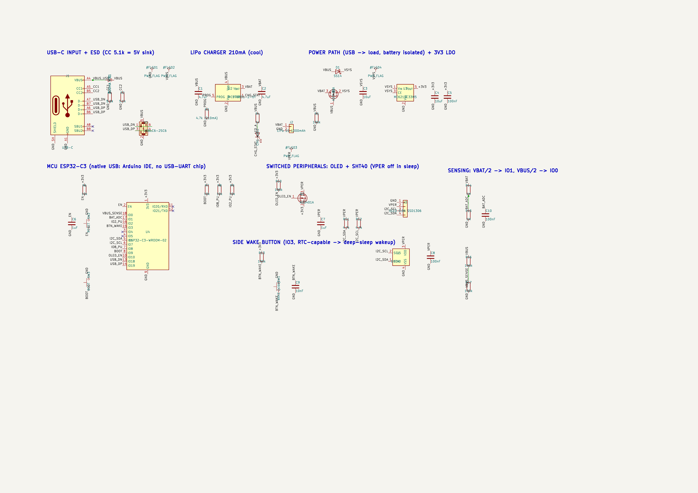
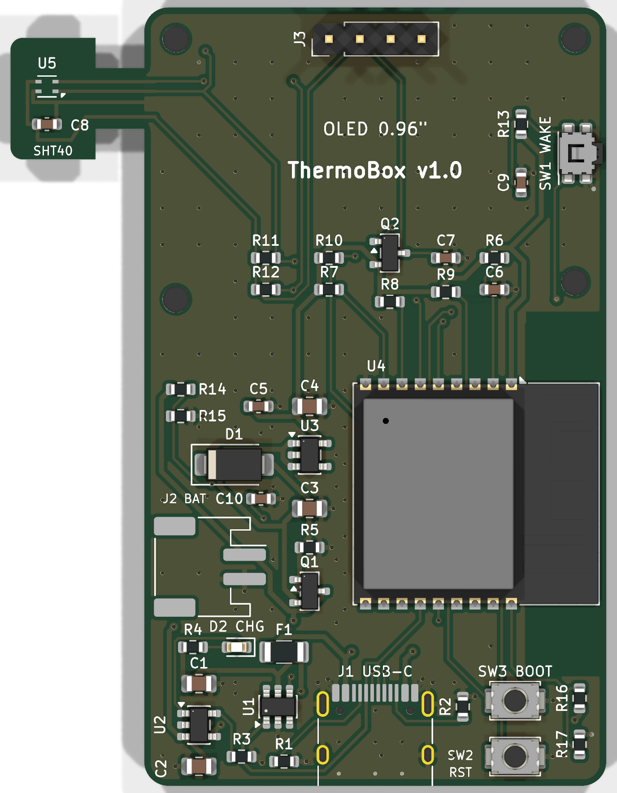
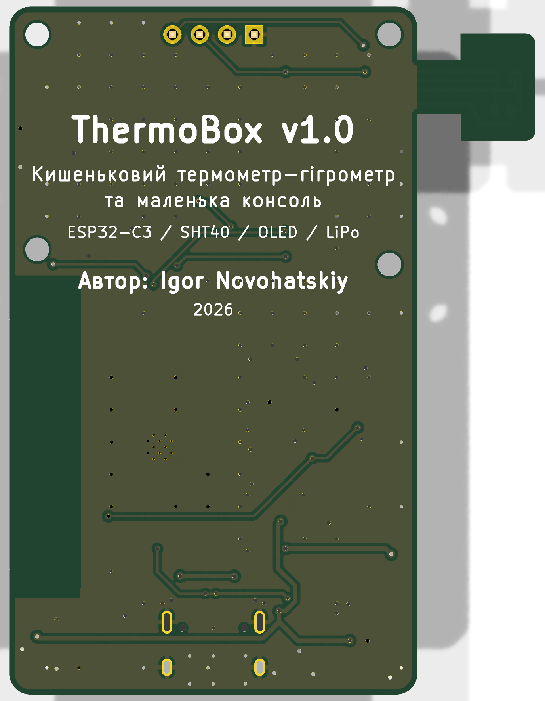

# ThermoBox — карманный термометр с играми на одну кнопку

**Автор:** Igor Novohatskiy, 2026

Маленькая коробочка: экран 0,96" OLED, датчик SHT40, аккумулятор LiPo, зарядка от USB‑C,
боковая кнопка будит устройство из глубокого сна. Программируется через тот же USB‑C прямо из Arduino IDE.

## Схема электрическая принципиальная



Схема в PDF: [docs/ThermoBox_schematic.pdf](docs/ThermoBox_schematic.pdf) · исходник KiCad 10: [ThermoBox.kicad_sch](ThermoBox.kicad_sch)

## Печатная плата



## Структура проекта

| Путь | Что внутри |
|---|---|
| `ThermoBox.kicad_pro / .kicad_sch / .kicad_pcb` | проект KiCad 10 (схема + плата) |
| `docs/schematic.png`, `docs/ThermoBox_schematic.pdf` | схема (картинка и PDF) |
| `docs/ThermoBox_pcb_top.pdf`, `docs/board_*_3d.png` | плата |
| `fab/gerbers/` | Gerber + сверловка для заказа (JLCPCB/PCBWay: заархивируй папку в zip) |
| `fab/ThermoBox_BOM.csv`, `fab/ThermoBox_positions.csv` | список компонентов и координаты для сборки |
| `fusion/` | **STEP, DXF контура и все размеры для корпуса** — см. [fusion/DIMENSIONS.md](fusion/DIMENSIONS.md) |
| `fusion/case/` | корпус: основание и крышка (STL для печати, STEP, F3D) |
| `firmware/ThermoBox/ThermoBox.ino` | прошивка для Arduino IDE |

## Как устроена схема (и почему так)

| Узел | Решение | Зачем |
|---|---|---|
| МК | **ESP32‑C3‑WROOM‑02** | встроенный USB: прошивка из Arduino IDE без отдельного USB‑UART; глубокий сон ~5 мкА; пробуждение по кнопке (GPIO3) |
| USB‑C | резисторы 5,1 кОм на CC1/CC2, предохранитель PTC 500 мА, ESD‑защита USBLC6‑2SC6 | работает с любым кабелем C‑C и A‑C; защита от статики и КЗ |
| Зарядка | **MCP73831**, ток **≈210 мА** (R3 = 4,7 кОм) | линейная зарядка: тепло = (5 В − Vбат) × I. При 210 мА это ≈0,3 Вт — чип тёплый, но не горячий. Аккумулятор 1000 мА·ч заряжается ≈5–5,5 ч. Для быстрой зарядки (≈300 мА) поставь R3 = 3,3 кОм — будет заметно горячее |
| Питание от USB или батареи | P‑MOSFET AO3401A + диод Шоттки SS14 (power path) | при подключённом USB устройство питается от USB, а аккумулятор только заряжается; без USB — питание от аккумулятора без потерь на диоде |
| 3,3 В | LDO ME6211C33 | ток покоя ~40 мкА; можно заменить на RT9080‑33 / XC6220B331 (тот же корпус и распиновка) — ток покоя 1–2 мкА, сон станет ещё дольше |
| Экран и SHT40 | питаются через ключ Q2 (линия **VPER**); подтяжки I²C тоже на VPER | во сне экран и датчик полностью обесточены, ничего не «подпитывается» через линии I²C |
| SHT40 | на отдельном **язычке**, соединённом с платой узким перешейком (5 мм), без меди на нижнем слое; в 45–50 мм от зарядки | тепло от зарядки, LDO и ESP32 почти не доходит до датчика; меряется температура воздуха, а не платы. Датчик опрашивается сразу после пробуждения, пока МК холодный |
| Измерения | VBAT/2 → GPIO1 (1 МОм + 1 МОм + 100 нФ), VBUS/2 → GPIO0 | уровень заряда в % и значок зарядки |
| Кнопки | SW1 — **боковая** (EVQ‑P7A) на GPIO3 с подтяжкой 100 кОм и RC‑антидребезгом; SW2 RESET, SW3 BOOT | SW1: пробуждение и игры; RESET/BOOT нужны только для аварийной прошивки |
| Индикатор | красный LED D2 горит во время зарядки | |

### Надписи на плате
На нижней стороне платы (шелкография) крупно напечатаны название **ThermoBox v1.0**, назначение («Кишеньковий термометр‑гігрометр та маленька консоль»), состав и **Автор: Igor Novohatskiy, 2026**.



### Тепло на плате
* Зарядка (U2), LDO (U3), диод D1 и MOSFET Q1 стоят в нижнем левом углу, у USB, подальше от датчика.
* Земля залита на обоих слоях и сшита ~140 переходными отверстиями: медь работает как радиатор.
* Силовые дорожки шириной 0,4 мм, сигнальные — 0,2 мм.
* Под антенной ESP32 меди нет (зона запрета), иначе Wi‑Fi/BLE будет работать плохо.

### Сколько проработает
* Сон: ESP32‑C3 ≈ 5 мкА + LDO ≈ 40 мкА + делитель ≈ 2 мкА ≈ **50 мкА** → 1000 мА·ч хватит примерно на 2 года чистого сна.
* Пробуждение на 10 с ≈ 35–40 мА. 20 просмотров в день ≈ 3–4 мА·ч в сутки → **≈ 8–10 месяцев** на одном заряде.
* Игры: ≈ 40 мА → около **25 часов** непрерывной игры.

## Прошивка через Arduino IDE

1. **Arduino IDE 2.x** → *File → Preferences → Additional boards manager URLs*:
   `https://espressif.github.io/arduino-esp32/package_esp32_index.json`
2. *Boards Manager* → установи **esp32 by Espressif Systems** (версия 3.x).
3. *Library Manager* → установи **U8g2** (by olikraus). Для SHT40 библиотека не нужна: он читается напрямую.
4. *Tools*:
   * Board: **ESP32C3 Dev Module**
   * USB CDC On Boot: **Enabled**
   * Flash Size: 4MB
   * Port: появившийся COM‑порт
5. Открой `firmware/ThermoBox/ThermoBox.ino` → **Upload**.

> **Важно:** в глубоком сне USB отключается. Перед прошивкой нажми боковую кнопку: пока подключён USB, устройство не засыпает 60 с.
> Если прошивка всё равно не находит порт (например, программа сразу уходит в сон или зависла):
> **зажми BOOT → нажми и отпусти RESET → отпусти BOOT**, затем Upload. После прошивки нажми RESET.

### Управление
| Действие | Результат |
|---|---|
| нажатие во сне | проснуться, показать температуру, влажность и заряд |
| короткое нажатие | экран «Температура» ↔ «Статистика» (мин/макс, напряжение, USB) |
| долгое нажатие (0,7 с) | меню игр |
| в меню: коротко / долго | следующая игра / запустить |
| 10 с без нажатий | глубокий сон (60 с, если подключён USB) |

Каждые 10 минут устройство тихо просыпается примерно на 30 мс и обновляет мин/макс температуры
(`LOG_INTERVAL_S` в прошивке; `0` — выключить).

### Игры (всё управление — одной кнопкой)
* **Cave Flyer** — держи кнопку, чтобы набирать высоту, отпусти, чтобы снижаться; пролетай в просветы.
* **Jump Runner** — нажимай, чтобы перепрыгивать блоки; скорость растёт.
* **Reaction** — дождись «GO!» и нажми как можно быстрее; результат в миллисекундах.

Рекорды сохраняются во флеш‑памяти (`Preferences`) и не пропадают при выключении питания.

### Как добавить свою игру
```cpp
uint32_t gameMyGame() {        // вернуть счёт
  uint32_t t = 0, score = 0;
  while (true) {
    if (!frameDue(t)) continue;        // ~30 кадров/с
    if (btnDown()) { /* ... */ }       // кнопка зажата
    oled.clearBuffer(); /* рисуем */ oled.sendBuffer();
    if (/* проигрыш */ false) return score;
  }
}
// и одна строка в массив GAMES[]:
//   {"My Game", gameMyGame, false},   // false = больше очков — лучше
```

## Сборка и проверка

1. Закажи плату по `fab/gerbers` (2 слоя, 1,6 мм; дорожки/зазоры ≥ 0,15 мм, отверстия ≥ 0,2 мм — стандартные возможности JLCPCB/PCBWay).
   Монтаж односторонний, все детали сверху: можно заказать сборку по `ThermoBox_BOM.csv` и `ThermoBox_positions.csv`.
2. Сначала без аккумулятора и экрана подключи USB: на `+3V3` должно быть 3,3 В, а светодиод зарядки погаснет или будет мигать (аккумулятора нет — это нормально).
3. Подключи аккумулятор, **проверив полярность** (пин 1 = «+»).
4. Экран: впаяй модуль его же штырями в J3, с пластиковой проставкой 2,5 мм (порядок пинов на модуле: **GND, VCC, SCL, SDA**; бывают модули с VCC‑GND — проверь надписи!).
5. Если изображение сдвинуто на 2 пикселя — у тебя контроллер SH1106: переключи строку `oled(...)` в начале прошивки.

## Проверки
* ERC схемы — 0 ошибок, 0 предупреждений.
* DRC платы — 0 ошибок, 0 неразведённых связей; осталось 2 предупреждения: шелкография самого USB‑разъёма заходит на край платы (так устроен посадочный шаблон, на производство не влияет).
